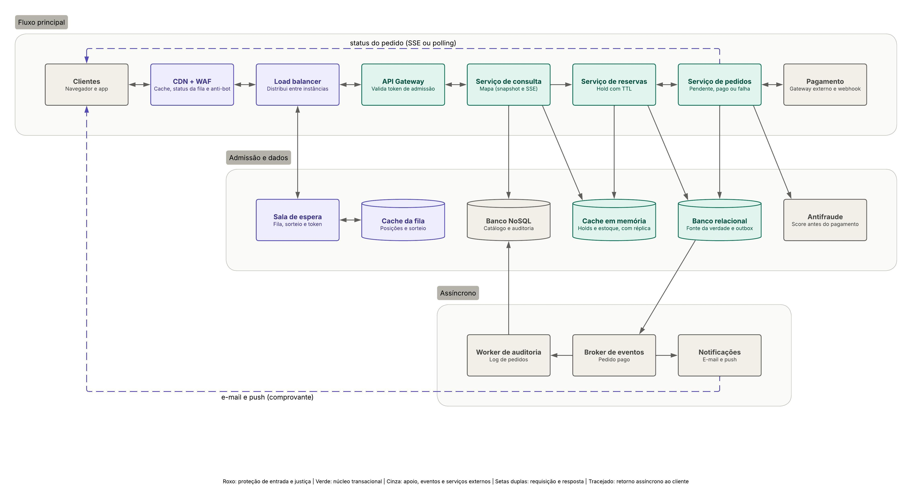

# system-design-assessment-bdc

## Problema
Imagine que você é o(a) arquiteto(a) responsável pelo desenho de um sistema de venda de ingressos para um site extremamente concorrido de ingressos de um mega show de Rock em Rio (got it?). Dado que o número de ingressos é limitado e muito inferior a quantidade de acessos no dia da venda, você precisa garantir que o sistema proposto vai conseguir lidar com a grande quantidade de acessos simultâneos o site só irá finalizar a venda para pessoas que realmente vão receber o ingresso, ou seja, você não pode deixar uma pessoa comprar um ingresso sem que haja mais disponíveis. Além disso, um cliente com internet mais lenta não ficaria feliz de não conseguir comprar seu ingresso pois uma pessoa com internet mais veloz passou sua frente.

Desenhe um diagrama de arquitetura de software que sustente esse serviço indepentende da demanda, pode ser um desenho simples, da maneira que você preferir, desde que o mesmo transmita a ideia da arquitetura que você teve para quem o lê.

## Diagrama 
